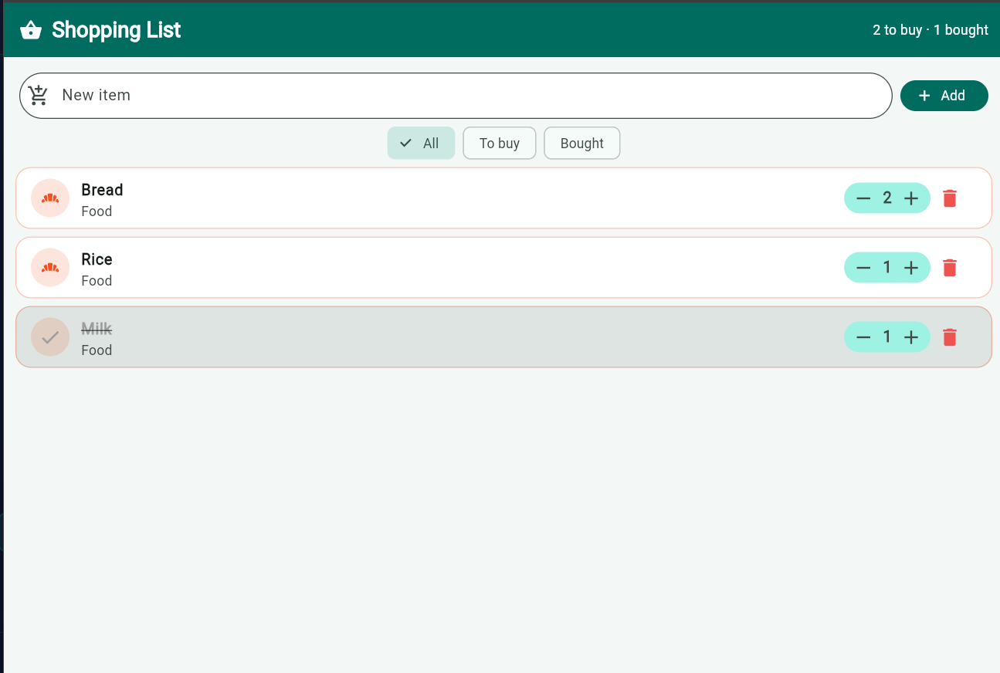
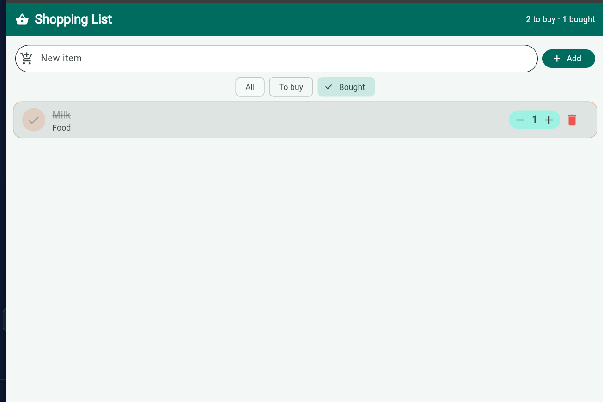

# Shopping List+

A Flutter shopping list app, upgraded into a real app.

## Features

1. **Nothing to show**: an empty list says *Your list is empty*.
2. **How many?**: every item has − quantity +, and the quantity never goes below 1.
3. **No duplicates, just more**: adding `milk` or ` MILK ` when Milk exists raises its quantity and says *Milk is already on the list: now ×2*.
4. **Oops: undo**: deleting shows *Bread removed* with an Undo button that puts the item back in exactly the same place.
5. **Show me what's left**: All / To buy / Bought filter chips. Bought items sit at the bottom of All, and an empty filter says *Nothing here*.
6. **Item details**: a long-press opens a second screen to edit the name, a note and the category (Food, Drinks, Home). Save keeps the changes, an empty name is refused, and the back arrow changes nothing.

## Screenshots

| Quantities | Undo | Bought filter | Item details |
|---|---|---|---|
|  |  |  |  |

## Think

**1. Why does deleting by `index` remove the wrong item when a filter is on? How did you fix it?**
The ListView shows the list `shown`, not `items`. With a filter on, `index` is a position in `shown`, so row 0 on the screen can be item 2 in `items`. `items.removeAt(index)` then removes a different item, with no error. I fixed it by deleting the item itself: `items.remove(item)`. To know where to put it back for Undo, I take `items.indexOf(item)` before removing it.

**2. Why did you have to remove `final` from `name`? Why is `final` still a good choice for most fields?**
`final` means a field is set once, in the constructor, and never changed. The details screen must rename an item, so `name` has to be changeable. `final` is still a good default: a value that cannot change cannot be changed by mistake somewhere else in the app, and the code is easier to reason about. You only remove it when changing the field is really part of the design.

**3. Why did you need a hot restart after adding `quantity` to `Item`, when a save was enough for everything else?**
Hot reload keeps the app's state: the objects in memory stay as they are, and only `build` runs again with the new code. The Milk, Bread and Rice objects were created before `quantity` existed, and their state was not created again. A hot restart throws the state away and runs the app from `main` again, so the items are created again with the new field.

**4. The details screen changed the item, but the list only showed it after `setState` in `.then`. Why? What does this tell you about how Flutter decides when to redraw?**
Flutter does not watch your variables. Changing `item.name` changes the data, but nothing tells Flutter the screen is out of date, so the old widgets stay on screen. `setState` marks the State as dirty, and Flutter calls `build` again on the next frame. Flutter redraws only when you tell it that something changed.

## Run it

```
flutter pub get
flutter run
```
